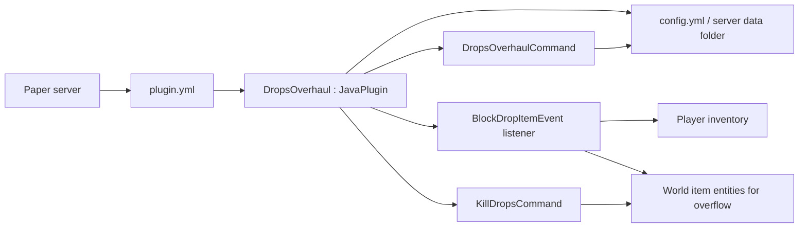

# Implemented port status

This section supersedes the historical snapshot below. That investigation is
retained as evidence of the pre-port architecture, not current behavior.

The root Paper build is preserved. `common/` is a dependency-free Java 8 drop
selection and inventory-overflow policy. Native adapters supply already-calculated
loot and native inventory operations; shared code never approximates loot.

* `legacy-spigot/`: actual Spigot 1.12.2, pinned to CraftBukkit `v1_12_R1`.
  Observes uncancelled breaks and handles actual native harvest item spawns.
  `LegacyHarvestOrigin` isolates the narrow stack-origin fence. It fails open for
  unrelated spawns and never disables block drops before loot exists. Explicit
  metadata mappings distinguish pre-flattening variants.
* `forge-1.12.2/`: native Forge 14.23.5.2864 HarvestDropsEvent adapter, including
  native modified loot and drop probability. Isolated Gradle 4.9 / JDK 8 build.
* `modern-spigot/`: existing Bukkit adapter compiled against Spigot 1.19 on Java
  17. Later exact versions require runtime tests before sharing this binary.
* `forge-1.19/`: native Forge 41.1.0 / EventBus 6 with an isolated Gradle 7.4.2
  and Java 17 toolchain. Its exact current validation state is in the manifest.
* `forge-1.21.11/`: native Forge 61.2.4 / EventBus 7, associating native item-join
  events with selected player breaks. Mavenizer requires build JDK 25; the mod and
  server use Java 21. No independent replacement loot calculation.
  The same isolated build selects Forge 1.20.6 / 50.2.14 and 1.21 / 51.0.5 through the manifest,
  reusing the EventBus 6 adapter from `forge-1.19/` and compiling it for Java 21.
  The 26.1 target reuses EventBus 7 with Java 25 and manifest-selected ForgeGradle
  7.0.17 for its unobfuscated dependency layout. See the matrix for runtime evidence.
  Small manifest-selected overflow shims retain the earlier native drop call and
  supply server-only prediction for the changed Minecraft 26.3 API.
* `forge-common/`: bounded safe YAML parsing, schema-2 configuration, atomic
  administrative saves, and shared configuration integration for both Forge builds.

`versions.json` owns exact targets, toolchains, artifact names, states, candidate
inventory, and release eligibility. [SUPPORT.md](SUPPORT.md) is generated from it.
Evidence records distribution hashes and individual scenarios. Modern Forge uses
an unmodified protocol client plus a separate test-only native event-hook mod;
the expanded scenarios assert cancellation, custom-event loot, gamerules, native
loot quantities, and durability. Complete parity across the advertised upstream
version groups has not been established.
The 26.2 and 26.3 targets have an explicit startup-only test mode because the
pinned protocol client lacks usable data for those versions. Their compilation
and server-load evidence must not be presented as gameplay or client compatibility.

The manual compatibility workflow installs real native servers. A separate manual
matrix runs Tier 1 boundaries or all Tier 2 candidates sequentially, preserving
per-target failure/blocker results. Neither promotes a compiled JAR into releases.
The standalone Paper release-staging task retains its explicit artifact eligibility.
The default `main.yml` workflow compiles consolidated distributions sequentially,
then signs and publishes successful outputs on pushes to main. Pull requests and
manual dispatch compile only. Build failures are reported without discarding
successful groups. Signed per-JAR reports and DISTRIBUTIONS.json distinguish
compilation from runtime support. The signing job checks out no source.
Paper/Spigot consolidation has separate runtime evidence. Native Forge groups
must have identical compiled payloads and explicit version sets in loader metadata.
The restrictive license remains unchanged; public redistribution rights are not
inferred from local implementation or testing.

# Historical baseline investigation

# DropsOverhaul: Technical Dissection

## 1. Repository Snapshot

**Repository:** `DropsOverhaul`  
**Checked-out revision:** `main` at `80e3d106223782e59f66a30a82abbaab9a3658cc` (short `80e3d10`)  
**Product version:** `4.2` (`build.gradle`)  
**Primary language:** Java 21  
**Build system:** Gradle Wrapper 9.4.0 with the `java` and `xyz.jpenilla.run-paper` plugins  
**Current runtime target:** a server-side Paper/Bukkit plugin for Paper API `1.21.11-R0.1-SNAPSHOT`.

The checked-out implementation prevents normal item-entity spawning for configured block types by observing Bukkit's `BlockDropItemEvent`, cancelling the event, and adding the event's already-calculated item stacks to the breaking player's inventory. It optionally deletes overflow; otherwise it drops that overflow at the player. It also exposes configuration-management and nearby-item cleanup commands.

This is a small, single-project Paper plugin. It currently has no Forge code, no `common` module, no Minecraft 1.12.2 build, and no automated test sources. Those are **future requirements stated in `AGENTS.md`**, not current implementation status. Do not represent the repository as Forge-capable or 1.12.2-compatible without adding and validating those deliverables.

## 2. Quick Start for Contributors

### Prerequisites

- A JDK 21 installation. `build.gradle` sets source, target, and `--release` to 21.
- Internet access on the first Gradle invocation to resolve the Gradle distribution, Paper API snapshot, and (for `runServer`) a Paper server.
- A Paper-compatible dedicated server to perform meaningful runtime testing. The plugin descriptor requires API version 1.21.

On Windows, point `JAVA_HOME` at JDK 21 before invoking the wrapper. In the inspected environment, `java` on `PATH` was JDK 21 but `JAVA_HOME` pointed to JDK 8; Gradle consequently refused to run. Example for the current PowerShell process:

```powershell
$env:JAVA_HOME = 'C:\Program Files\Eclipse Adoptium\jdk-21.0.9.10-hotspot'
$env:Path = "$env:JAVA_HOME\bin;$env:Path"
.\gradlew.bat --version
.\gradlew.bat jar
```

On macOS/Linux:

```sh
export JAVA_HOME=/path/to/jdk-21
./gradlew --version
./gradlew jar
```

`jar` creates the distributable JAR under `build/libs/`. `build` is the stricter CI command and is appropriate before publishing changes. `runServer` is supplied by the run-paper plugin for local Paper development; it has not been exercised for this briefing and needs a compatible Java 21 environment and its normal server-download/EULA prerequisites.

Primary entrypoints:

- Runtime: `src/main/java/org/infotoast/dropsoverhaul/DropsOverhaul.java`
- Plugin metadata: `src/main/resources/plugin.yml`
- Default configuration: `src/main/resources/config.yml`
- Build: `build.gradle`

## 3. Repository Map

```text
.
├── src/main/java/org/infotoast/dropsoverhaul/
│   ├── DropsOverhaul.java                 # JavaPlugin lifecycle and block-drop listener
│   └── command/
│       ├── DropsOverhaulCommand.java      # /dropsoverhaul (alias /do)
│       └── KillDropsCommand.java          # /killdrops (alias /kd)
├── src/main/resources/
│   ├── plugin.yml                         # Bukkit discovery, commands, permissions
│   └── config.yml                         # Default persisted server configuration
├── gradle/wrapper/                         # Pinned Gradle launcher (9.4.0)
├── build.gradle                            # One Gradle Java project; Paper dependency
├── settings.gradle                         # Root project name only
├── .forgejo/workflows/main.yml             # Primary build/sign/release workflow
├── .github/workflows/gradle.yml            # GitHub build-and-artifact workflow
├── README.md                               # Brief user-oriented installation description
├── AGENTS.md                               # Architectural direction and contribution constraints
└── LICENSE.md                              # Custom restrictive license text
```

`build/` and `.gradle/` are generated/local directories and are ignored. There is no `src/test`, no scripts directory, no submodule, no lockfile, and no nested agent instruction file in the revision inspected.

## 4. System Architecture

The implementation uses the Paper/Bukkit plugin model directly. There is no independent domain layer: configuration lookups, event handling, inventory interaction, and messages all occur in Bukkit-facing classes.



| Component | Location and entrypoint | Responsibility and dependencies |
| --- | --- | --- |
| Plugin lifecycle and drop adapter | `DropsOverhaul`, `onEnable`, `onBlockDrop` | Extends `JavaPlugin`, registers itself as a `Listener`, manages the default config, and uses Bukkit `BlockDropItemEvent`, `PlayerInventory`, `World`, and `ItemStack`. |
| Main administrative command | `command/DropsOverhaulCommand`, `onCommand` | Implements reload, add-block, remove-block, list, help, permissions, configurable messages, and YAML persistence through the plugin instance. |
| Cleanup command | `command/KillDropsCommand`, `onCommand` | Finds nearby Bukkit `Item` entities around a player and removes them. |
| Server contract | `resources/plugin.yml` | Declares the JavaPlugin main class, Paper API level, two commands/aliases, and five permissions. Bukkit reads it from the packaged JAR. |
| Persistent defaults | `resources/config.yml` | Provides the version marker, behavior flags, configured materials, radii, and color-coded messages. Paper copies it into the plugin data folder. |

The only explicit architectural pattern is the framework adapter/command-executor pattern imposed by Bukkit: `DropsOverhaul` is both lifecycle object and listener, while commands implement `CommandExecutor`. No shared-platform abstraction, repository, service layer, or storage adapter exists today.

## 5. Startup and Execution Flow

1. Paper discovers `plugin.yml`, instantiates `org.infotoast.dropsoverhaul.DropsOverhaul`, and calls `onEnable()`.
2. `onEnable()` calls `saveDefaultConfig()`. It checks the root `Config-Version`; a missing marker, an old nested `Settings.Config-Version`, or a version other than `2` invokes `saveOldConfigAndMakeNew()`.
3. The migration routine renames the data-folder `config.yml` to `config-old.yml`, overwrites `config.yml` from bundled resources, and logs warnings that settings must be remade. Rename success is not checked.
4. The plugin registers `/dropsoverhaul` and `/killdrops` executors and registers itself for events.
5. For every `BlockDropItemEvent`, `onBlockDrop` compares `event.getBlockState().getType().name()` exactly with `Settings.Drops-To-Remove`. Unlisted material names retain vanilla handling.
6. For a listed block it cancels the event, copies the event's item stacks, and calls `PlayerInventory.addItem`. Therefore the native event has already determined such things as loot, Silk Touch, Fortune, and tool mechanics before the plugin transfers the resulting stacks.
7. If overflow remains and `Settings.Full-Inventory-Delete` is false, each leftover stack is dropped naturally at the player's location. When true (the default), overflow is discarded.

The code does not create replacement loot based on block identity. This helps preserve the event's calculated drops, but cancellation/event ordering means integration with other plugins or Paper event priorities must be manually tested.

## 6. Functional Inventory

### Implemented and source-verified

| Feature | Activation and primary path | Configuration / important behavior |
| --- | --- | --- |
| Direct inventory delivery for selected drops | `BlockDropItemEvent` → `DropsOverhaul.onBlockDrop` | Exact uppercase `Material.name()` matching against `Settings.Drops-To-Remove`; event cancellation; calculated event stacks are inserted. |
| Overflow policy | Same event handler | `Settings.Full-Inventory-Delete: true` deletes leftovers. `false` drops leftovers at the player location. |
| Config compatibility reset | Plugin startup | Only root config schema version `2` is accepted. Other/missing/legacy nested markers trigger replacement with defaults and an attempted `config-old.yml` backup. |
| Reload configuration | `/dropsoverhaul reload` or `/do reload` | Requires `dropsoverhaul.reload`; invokes `reloadConfig()`. |
| Add configured material | `/dropsoverhaul addblock <block>` | Requires `dropsoverhaul.addblock`; validates with `Material.valueOf`, appends uppercase text, then `saveConfig()`. It does not prevent duplicates or check `Material.isBlock()`. |
| Remove/list configured materials | `/do removeblock <block>`, `/do list` | Require their respective permissions; changes persist through `saveConfig()`. |
| Nearby entity cleanup | `/killdrops [radius]` or `/kd [radius]` | Requires `dropsoverhaul.killdrops`; player-only. It removes all `Item` entities in the configured/default radius. A supplied radius additionally requires `dropsoverhaul.killdrops.radius`. |
| Colored configurable feedback | `DropsOverhaul.colorize` | Converts `&` colour codes and reads text from `Messages.*`, with code-level fallback strings for some missing entries. |

### Documented versus current code

The README says the plugin handles a listed set of “junk blocks” and gives `gradlew jar` build instructions. Its current material list is broadly consistent with `config.yml`, but it is not an authoritative compatibility statement: the implementation actually handles whatever strings are configured. The README does not document current commands, permissions, config version migration, Paper 1.21.11, Java 21, or the intended future Forge port.

### Planned, not implemented

`AGENTS.md` requires a native Forge server implementation, shared platform-neutral gameplay logic, independently buildable Paper and Forge artifacts, and mandatory 1.12.2 support for both. None has a source set, build task, configuration, test, or artifact in the current tree.

### Confirmed incomplete or fragile behavior

- `DropsOverhaulCommand.removeBlock` accesses `args[1]` without first ensuring an argument exists; `/do removeblock` with no block can throw `ArrayIndexOutOfBoundsException`.
- `KillDropsCommand` uses `Integer.parseInt(args[0])` without validation. A non-numeric radius can throw `NumberFormatException`; negative/large values are not bounded in this code.
- The list heading lookup is misspelled as `Messasges.Command.List-Header`, while the default key is `Messages.Command.List-Header`; it falls back to the supplied default header.
- `plugin.yml` describes `dropsoverhaul` as also killing nearby items, but cleanup is registered as the separate `/killdrops` command; `Messages.Command.Kill-Drops-Command` says `/do killdrops`, which has no handler.
- The default overflow mode intentionally loses selected drops when inventories are full. This is configurable behavior, not an accidental implementation claim.

No runtime server validation was performed here, so these observations are code-level findings, not reproduced live-server results.

## 7. Dependencies and Toolchains

| Item | Declared version / role | Constraint |
| --- | --- | --- |
| Java | 21 | Required by `sourceCompatibility`, `targetCompatibility`, and `options.release`; modern Java APIs such as `List.addLast` are used. |
| Gradle Wrapper | 9.4.0 | Pinned in `gradle/wrapper/gradle-wrapper.properties`; use the wrapper rather than an arbitrary system Gradle. |
| Paper API | `io.papermc.paper:paper-api:1.21.11-R0.1-SNAPSHOT` | `compileOnly`; it is supplied by Paper at runtime and must not be bundled as a server API dependency. It is a snapshot, so resolution can be time-sensitive. |
| run-paper Gradle plugin | `xyz.jpenilla.run-paper:3.0.2` | Provides `runServer` and is configured for Minecraft 1.21.11. |
| Repositories | Maven Central, PaperMC public, Sonatype public | Declared in `build.gradle`; no dependency locking is configured. |

The local `gradle.properties` is empty. There are no environment variables or credentials required by normal local compilation in checked-in files. Release-only CI uses secrets named `CI_KEY_B64`, `CI_KEY_PASSPHRASE`, and the Forgejo-provided token/context variables; no values are present in the repository.

## 8. Build and Packaging

The project is a single Gradle project named `DropsOverhaul` (`settings.gradle`). It has the ordinary Java `main` source set. Resource processing expands `${version}` in `plugin.yml`, so the packaged descriptor receives `4.2`.

| Goal | Command | Expected result |
| --- | --- | --- |
| Inspect wrapper/toolchain | `./gradlew --version` / `.\gradlew.bat --version` | Gradle must run on a JVM 17+; use JDK 21 to match compilation. |
| Assemble plugin | `./gradlew jar` / `.\gradlew.bat jar` | JAR under `build/libs/`, including `plugin.yml`. |
| CI-equivalent lifecycle | `./gradlew build --no-daemon` | CI build stage; no test sources currently exist, so validation is chiefly compilation/packaging. |
| Local Paper development | `./gradlew runServer` | run-paper development server for 1.21.11; not validated during this review. |

The GitHub workflow uses `jar`; the Forgejo workflow uses `build --no-daemon`. Neither build configuration creates source/javadoc/test artifacts intentionally. The release workflow only accepts a JAR containing `plugin.yml` and copies it to a temporary `dist/` directory.

**Validation performed for this briefing:** `java -version` reported Temurin JDK 21.0.9; `gradlew.bat --version` reported Gradle 9.4.0 but its launcher JVM as JDK 8 because `JAVA_HOME` was set to JDK 8. `gradlew.bat tasks --all` then failed before configuration with “Gradle requires JVM 17 or later.” No `jar`, `build`, tests, Paper server, release workflow, or deployment was run. Consequently, a successful build is not claimed for this checkout.

## 9. Configuration and State

`config.yml` is bundled and copied to the plugin data folder by Bukkit. Runtime commands mutate the active YAML configuration and `saveConfig()` writes it back. There is no database, network state, cache, or application-owned persistent state besides this file and the attempted `config-old.yml` backup.

| Key | Default | Effect |
| --- | --- | --- |
| `Config-Version` | `2` | Startup schema guard. Values other than `2` cause configuration replacement. |
| `Settings.Kill-Drops-Radius` | `20` | Default search radius for `/killdrops`. |
| `Settings.Full-Inventory-Delete` | `true` | Whether selected-drop overflow is discarded instead of dropped. |
| `Settings.Drops-To-Remove` | 17 Material names | Exact material-name allowlist for direct inventory routing. |
| `Messages.*` | colour-coded messages | Server feedback and help text. |

Configuration edits need care: adding newer material names cannot create legacy-version compatibility; for example, 1.12.2 uses pre-flattening names/metadata and is not supported by this runtime. Startup migration is destructive to the current config contents after a best-effort rename, so back up a production config before changing schema behavior.

## 10. Tests and Quality Assurance

There are no `src/test` sources, unit-test dependencies, test fixtures, integration harnesses, or end-to-end tests. `build` therefore does not establish gameplay correctness. The only automated validation visible in the repository is compilation/packaging in CI.

Minimum manual validation after touching the relevant areas:

| Change area | Minimum validation |
| --- | --- |
| Drop listener or configured material behavior | Dedicated Paper 1.21.11 server: listed/unlisted blocks; Silk Touch; Fortune; inventory-full with both policies; creative; cancellation/other-plugin interaction; no duplicate or missing drops. |
| Commands/configuration | All permissions, console versus player invocation, missing/invalid arguments, persistence after restart, reload, and migration backup behavior. |
| `plugin.yml` or build changes | `jar`, inspect JAR for `plugin.yml`, and start a dedicated server with the JAR. |
| CI/release workflow | Non-release pull-request/push build first; verify artifact selection/signatures in the CI platform without publishing from an untrusted branch. |

For the future Forge/1.12.2 project objective, compilation would be insufficient: the platform-specific dedicated server must load the mod without client installation, parse compatible configuration, and exercise equivalent drop/inventory behavior.

## 11. CI/CD and Releases

### Forgejo: `.forgejo/workflows/main.yml`

The primary workflow runs for pushes and pull requests to `main`.

1. `build` runs on `ubuntu-latest` in `node:24-bookworm`, checks out without persistent credentials, installs Temurin 21, runs `./gradlew build --no-daemon`, verifies packaged `plugin.yml`, and uploads `plugin-jars`.
2. `release` runs only on a push to `main` and only after `build`. It deliberately does not check out or execute repository build scripts. It downloads the verified artifact, imports the CI GPG key, generates `SHA256SUMS`, creates detached ASCII signatures, verifies both signatures and checksums, then uses the Forgejo API to create a commit-specific prerelease.
3. The tag format is `build-<first 12 SHA characters>`. The workflow refuses to replace a release with the same tag and has checks for HTTPS API URLs, SHA format, repository format, tag collisions, and uploaded asset inventory. It creates a draft before publishing it.

Release signing requires `CI_KEY_B64` and `CI_KEY_PASSPHRASE`; publication uses the Forgejo workflow token. Values must remain only in CI secrets. The workflow checks whether `main` reports as protected but warns rather than failing if it is not.

### GitHub: `.github/workflows/gradle.yml`

This independent CI workflow runs on pushes/pull requests to `main`, uses Zulu 21, runs `jar` through `gradle/gradle-build-action`, and uploads `build/libs` as `DropsOverhaul`. It signs or publishes nothing.

There is no user deployment automation. Distribution is the packaged Paper plugin JAR plus CI artifacts or signed Forgejo prerelease assets.

## 12. Development Conventions

- Package names use `org.infotoast.dropsoverhaul`; command classes live in a `command` subpackage.
- The code is concise, direct Bukkit API code with one public class per file, camelCase methods/variables, and `@NotNull` command parameters.
- Configuration paths are literal YAML dotted strings, and feedback is routed through `DropsOverhaul.colorize` with `&` codes.
- Runtime API is Paper/Bukkit only. Do not introduce server API classes into a future shared module.
- `plugin.yml`, `config.yml`, and the Java registration code must remain coordinated whenever commands, permissions, config keys, or the main class change.
- Gradle resources perform version substitution in `plugin.yml`; do not hand-edit a generated JAR descriptor.
- `.gradle/`, `build/`, `run/`, and ordinary archives are ignored/generated. The Gradle wrapper JAR is deliberately exempted from the broad archive ignore rule.
- `LICENSE.md` is restrictive and internally unusual: it permits use but says redistribution, modification, and even reading source code are not legal. Confirm licensing/redistribution authority before distributing modified artifacts or accepting external changes.

`AGENTS.md` additionally establishes the desired future constraints: preserve the Paper plugin, use native Forge rather than a bridge, make platform/gameplay code shareable where actually possible, retain dedicated-server suitability, avoid silent old-version substitution, and validate runtime behavior rather than claiming parity from compilation.

## 13. Where to Make Changes

| Objective | Start here | Coordinated inspection |
| --- | --- | --- |
| Change selected-drop behavior | `DropsOverhaul.onBlockDrop` | `config.yml`, Paper event ordering, inventory overflow behavior, manual gameplay matrix. |
| Change default blocks or messages | `src/main/resources/config.yml` | Command persistence, config-version migration, docs, and target Paper `Material` names. |
| Add/change `/do` subcommands | `command/DropsOverhaulCommand.java` | `plugin.yml`, permissions, message keys, argument validation, README. |
| Change `/killdrops` | `command/KillDropsCommand.java` | Radius validation, permissions in `plugin.yml`, `Settings.Kill-Drops-Radius`, player/console behavior. |
| Change startup/config migration | `DropsOverhaul.onEnable` and `saveOldConfigAndMakeNew` | Existing production-config compatibility and safe backup/failure handling. |
| Change Paper/Minecraft version | `build.gradle` and `plugin.yml` | Java compatibility, `runServer` version, CI JDK, Paper API availability, dedicated-server smoke testing. |
| Change packaging/dependencies | `build.gradle`, wrapper files | `processResources`, compile-only API policy, both CI workflows. |
| Change release policy | `.forgejo/workflows/main.yml` | Branch protection, artifact provenance, signing secrets, draft/retry behavior. |
| Begin Forge/legacy support | First inspect `AGENTS.md` and current Paper behavior | Create isolated compatible builds/modules only after preserving the existing Paper path; establish a 1.12.2 material/metadata plan and tests. |

## 14. Known Issues, Constraints, and Technical Debt

### Verified from the checkout

- Current supported build configuration is only Paper API/Minecraft 1.21.11 and Java 21. Forge and 1.12.2 support are absent.
- No automated tests exist, leaving inventory, event-ordering, permission, migration, and dedicated-server loading regressions to manual checks.
- Commands have the missing-argument and parsing failure paths listed in the functional inventory.
- Configuration migration can replace user configuration after an unchecked filesystem rename.
- The project depends on a Paper API snapshot without dependency locking.
- README and some user-facing command metadata/messages are stale or inconsistent with implementation.
- The current listener relies on exact modern `Material` enum names, incompatible with a direct 1.12.2 configuration reuse.
- There is no explicit validation that the `addblock` material is a block, no duplicate prevention, and no radius bounds.

### Reasonable inference, requiring confirmation before action

- The single-class listener is the likely extraction point for future platform-neutral policy, but no separation exists today and a shared abstraction should not be invented until Forge's event/loot constraints are mapped.
- The high-level architecture in `AGENTS.md` is a roadmap, not evidence of an agreed detailed module design or a completed migration plan.
- CI’s container image is Node-based even though the project is Java-based; Java is installed explicitly, so this is unusual but not itself proven incorrect.

## 15. Important Historical Context

Relevant history explains the current small architecture:

- `68c760a` (2022-12-16) introduced the initial plugin structure.
- `443f0b0` (2024-05-21, “Code overhaul/cleanup”) replaced earlier `Plugin`, `Listener`, and `ItemLists` classes with the current `DropsOverhaul` JavaPlugin/listener plus command package. Treat this as the major architecture consolidation, not as evidence of a platform abstraction.
- `11ae51c` and `497c28e` (2024-05-19) changed the old listener for inventory and Unbreaking-related issues. The current event-driven approach should be regression-tested carefully around tool/drop mechanics.
- `265375c` (2024-07-06) added the separate kill-drops command and its related configuration.
- `3150452` (2025-02-08) changed the config marker to root version 2 and added add/remove/list management commands.
- Subsequent commits updated the Paper target through 1.21.11 and set product version 4.2.
- `e8872b4`, `a2709ee`, and `80e3d10` (2026-11-19) added and hardened Forgejo CI/release automation. The present release workflow signs verified build artifacts and refuses replacement collisions.

Commit subjects are terse, so rationale beyond the diffs is unknown. In particular, repository history does not establish a Forge design, legacy material mapping, or 1.12.2 compatibility approach.

## 16. Contributor Preflight Checklist

- [ ] Read `AGENTS.md`, this document, `build.gradle`, `plugin.yml`, and the component to be changed.
- [ ] Confirm JDK 21 is active for Gradle (`JAVA_HOME` and `./gradlew --version`).
- [ ] Check `git status`; preserve unrelated work and do not edit generated directories.
- [ ] Identify all coordinated resources: Java registrations, `plugin.yml`, config keys/messages, build tasks, and CI where applicable.
- [ ] Back up a production config before touching migration/schema behavior.
- [ ] Run the appropriate Gradle packaging command and inspect its actual outcome; do not claim success from configuration review.
- [ ] Perform the relevant dedicated-server/manual tests, especially drops, full inventory, enchantments, permissions, and command error paths.
- [ ] For platform/version work, update an explicit support matrix and validate each claimed artifact on its actual server runtime.
- [ ] Review the restrictive license and release-signing requirements before publishing or redistributing.
- [ ] Update contributor-facing documentation when behavior, commands, configuration, compatibility, or build instructions change.

## 17. Open Questions

1. Which Paper/Spigot versions beyond the current 1.21.11 target are intentionally supported, if any?
2. Does the restrictive `LICENSE.md` reflect the fork owner’s intended policy and permit the planned Forge port and redistribution of modified builds?
3. What exact Forge versions/build toolchains and server-only loading strategy are required, beginning with mandatory 1.12.2?
4. How should legacy 1.12.2 block IDs/metadata map to the modern material allowlist without silently changing behavior?
5. Is intentional deletion of overflow (`Full-Inventory-Delete: true`) still the desired default, and how should it be communicated to administrators?
6. Should the current configuration migration preserve user keys instead of resetting the file, and what backup-failure behavior is acceptable?
7. Are the current Forgejo runner label, container image, branch-protection warning policy, and signing secret rotation practices operationally verified?
8. What dedicated-server compatibility test matrix is required before the project can claim Paper/Forge behavioral parity?

